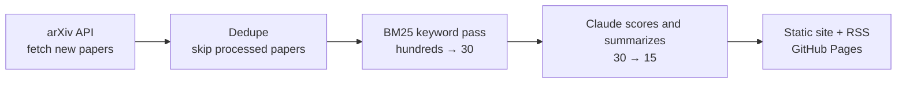

# arXiv Radar

[中文](README.md)

Every day, arXiv Radar picks the dozen or so new papers closest to your research from the hundreds on arXiv, summarizes them, and publishes the result as a web page and an RSS feed.

Fork it, edit one config file, and it runs on GitHub Actions. You don't need a server.

## How it works



- **Two-stage filtering:** a free keyword ranking runs first, and only the top 30 papers reach the model. API cost stays roughly flat however much arXiv publishes.
- **Scored against your interests:** describe what you care about in plain language. The model scores each paper from 1 to 10 and says why it's relevant.
- **Works without an API key:** papers are then ranked by keyword only, with no summaries, and the page says so.
- **No repeats:** a processed paper never appears again.

## Deploy to GitHub (about 5 minutes)

1. **Fork this repository**, then delete any inherited `digests/` and `seen.json` from `data/`.
2. **Edit [config.yaml](config.yaml):** change at least `categories`, `interests` and `keywords`. Set `language: en` for English output.
3. **Add your key:** under Settings → Secrets and variables → Actions, create `ANTHROPIC_API_KEY`.
4. **Turn on Pages:** under Settings → Pages, set Source to GitHub Actions.
5. **Enable and run:** on the Actions tab, enable workflows (forks start with them off), choose Daily radar, and click Run workflow.

Your page will be at `https://<your-username>.github.io/<repo-name>/`, with the feed at `feed.xml` under the same address. It updates every weekday at 02:00 UTC.

## Run locally

You need Python 3.10 or later.

```bash
git clone https://github.com/<your-username>/arxiv-radar.git
cd arxiv-radar
python -m venv .venv
```

Activate the virtual environment (on Windows PowerShell, use `.venv\Scripts\Activate.ps1`):

```bash
source .venv/bin/activate
```

Install it and try a run without an API key:

```bash
pip install -e ".[dev]"
arxiv-radar run --no-llm
```

Then open `site/index.html`.

A local trial also marks papers as processed, so the model won't summarize them later. To start over, delete `digests/` and `seen.json` from `data/`.

To get summaries, set the `ANTHROPIC_API_KEY` environment variable and run `arxiv-radar run`.

| Command | What it does |
|---|---|
| `arxiv-radar run` | Fetch, filter, summarize and build the site |
| `arxiv-radar run --no-llm` | Rank by keyword only, without calling the model |
| `arxiv-radar build` | Rebuild the site from saved data |
| `pytest` | Run the tests |

## Configuration

All settings live in [config.yaml](config.yaml).

| Setting | Default | Description |
|---|---|---|
| `categories` | required | [arXiv categories](https://arxiv.org/category_taxonomy) to watch |
| `interests` | required | Your interests in plain language; the model scores against this |
| `keywords` | required | English keywords for the first pass |
| `exclude_keywords` | empty | Papers containing these are dropped |
| `language` | `zh` | Language for summaries and page labels: `zh` or `en` |
| `lookback_days` | `5` | Days to look back; keep this at 5 or more to cover arXiv's weekend backlog |
| `max_fetch` | `3000` | Most papers fetched per run |
| `max_candidates` | `30` | Papers sent to the model per run; this drives the API cost |
| `max_papers` | `15` | Most papers shown per digest |
| `min_score` | `6` | Lowest score (1–10) that makes the digest |
| `llm.model` | `claude-opus-5-5` | Claude model to use |
| `llm.effort` | `low` | How much the model reasons |
| `llm.refusal_fallback` | `true` | If the model declines a paper, retry on a fallback model in the same call |

**Specific keywords make a better first pass.** Broad words like `evaluation` or `benchmark` match most papers, which can push relevant ones out of the top 30.

To use a gateway compatible with the Anthropic API, add an `ANTHROPIC_BASE_URL` secret and set `llm.refusal_fallback` to `false`. This setup hasn't been tested.

## Cost

GitHub Actions and Pages are free for public repositories, so you only pay for model calls. These are rough estimates, not measurements, assuming about 750 input and 350 output tokens per paper:

| Model | Per run (30 papers) | Per month (22 weekdays) |
|---|---|---|
| `claude-opus-5-5` (default) | about $0.30 | about $6.60 |
| `claude-haiku-5-5` | about $0.01 | about $0.20 |

To spend less, switch models or lower `max_candidates`.

## When things go wrong

- **The model declines a paper, or one call fails:** the paper stays at the end of the digest, marked as having no AI summary. Other papers are unaffected.
- **Bad API key or model name:** the run stops at once and publishes nothing partial. Fix it and run again.
- **arXiv is temporarily down:** requests retry up to 3 times, at least 3 seconds apart, in line with arXiv's terms of use.

## Roadmap

- [ ] Semantic first pass with embeddings, to catch papers keywords miss
- [ ] Related papers: show how a new paper connects to ones you read recently
- [ ] Email delivery
- [ ] Adjust your interests automatically from papers you mark

Issues and pull requests are welcome.

## Acknowledgements

Thank you to arXiv for use of its open access interoperability.

This project is not affiliated with arXiv. AI summaries can be wrong, so check the paper.

## License

[MIT](LICENSE)
