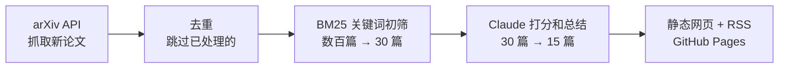

# arXiv 论文雷达

[English](README.en.md)

每天从 arXiv 数百篇新论文里，挑出和你研究方向最相关的十几篇，生成中文摘要，并发布成网页和 RSS。

Fork 后改一份配置就能用。它运行在 GitHub Actions 上，不需要服务器。

## 工作流程



- **两级筛选：** 免费的关键词排序先过滤，只有前 30 篇才调用模型。无论 arXiv 当天发多少论文，API 费用都基本固定。
- **按你的方向打分：** 用自然语言写下你关心什么，模型据此给每篇论文打 1–10 分，并说明推荐理由。
- **没有 API Key 也能运行：** 这时只按关键词排序，不生成摘要，页面上会有提示。
- **不重复：** 处理过的论文不会再次出现。

## 部署到 GitHub（约 5 分钟）

1. **Fork 本仓库**，然后删除 `data/` 里继承来的 `digests/` 和 `seen.json`（如果有）。
2. **修改 [config.yaml](config.yaml)**：至少改 `categories`、`interests` 和 `keywords`。
3. **添加密钥**：在 Settings → Secrets and variables → Actions 中新建 `ANTHROPIC_API_KEY`。
4. **开启 Pages**：在 Settings → Pages 中，把 Source 设为 GitHub Actions。
5. **启用并运行**：在 Actions 页面启用工作流（Fork 的仓库默认关闭），选择 Daily radar，点击 Run workflow。

运行完成后，页面地址是 `https://<你的用户名>.github.io/<仓库名>/`，RSS 在同一地址下的 `feed.xml`。之后每个工作日的 UTC 02:00（北京时间 10:00）会自动更新。

## 本地运行

需要 Python 3.10 或更高版本。

```bash
git clone https://github.com/<你的用户名>/arxiv-radar.git
cd arxiv-radar
python -m venv .venv
```

激活虚拟环境（Windows PowerShell 用 `.venv\Scripts\Activate.ps1`）：

```bash
source .venv/bin/activate
```

安装后先不用 API Key 跑一次：

```bash
pip install -e ".[dev]"
arxiv-radar run --no-llm
```

然后打开 `site/index.html` 查看结果。

本地试跑也会把论文记为已处理，这些论文之后不会再由模型总结。想重新开始，删除 `data/` 里的 `digests/` 和 `seen.json` 即可。

要生成摘要，先设置 `ANTHROPIC_API_KEY` 环境变量，再运行 `arxiv-radar run`。

| 命令 | 作用 |
|---|---|
| `arxiv-radar run` | 抓取、筛选、总结，然后生成网页 |
| `arxiv-radar run --no-llm` | 只按关键词排序，不调用模型 |
| `arxiv-radar build` | 只根据已保存的数据重新生成网页 |
| `pytest` | 运行测试 |

## 配置

所有配置都在 [config.yaml](config.yaml) 中。

| 配置项 | 默认值 | 说明 |
|---|---|---|
| `categories` | 必填 | 要关注的 [arXiv 分类](https://arxiv.org/category_taxonomy) |
| `interests` | 必填 | 用自然语言描述研究兴趣，模型据此打分 |
| `keywords` | 必填 | 初筛用的英文关键词 |
| `exclude_keywords` | 空 | 包含这些词的论文会被直接排除 |
| `language` | `zh` | 摘要和页面的语言，可选 `zh` 或 `en` |
| `lookback_days` | `5` | 回溯天数。arXiv 周末积压较多，建议不小于 5 |
| `max_fetch` | `3000` | 每次最多抓取的论文数 |
| `max_candidates` | `30` | 每次送给模型的论文数，决定 API 费用 |
| `max_papers` | `15` | 每期最多展示的论文数 |
| `min_score` | `6` | 入选的最低分（1–10） |
| `llm.model` | `claude-opus-5-5` | 使用的 Claude 模型 |
| `llm.effort` | `low` | 模型的思考深度 |
| `llm.refusal_fallback` | `true` | 模型拒绝处理某篇论文时，是否在同一次调用内改用备用模型 |

**关键词写得越具体，初筛越准。** `evaluation`、`benchmark` 这样的宽泛词会命中大多数论文，真正相关的论文可能排不进前 30。

如果使用兼容 Anthropic API 的网关，可以添加 `ANTHROPIC_BASE_URL` 密钥，并把 `llm.refusal_fallback` 设为 `false`。这种用法尚未经过测试。

## 费用

GitHub Actions 和 Pages 对公开仓库免费，只有模型调用需要付费。下面是按每篇论文约 750 个输入 token、350 个输出 token 算出的粗略估计，还没有实测：

| 模型 | 每次运行（30 篇） | 每月（22 个工作日） |
|---|---|---|
| `claude-opus-5-5`（默认） | 约 $0.30 | 约 $6.6 |
| `claude-haiku-5-5` | 约 $0.01 | 约 $0.2 |

想降低费用，可以换模型，或者调小 `max_candidates`。

## 处理异常的方式

- **模型拒绝或单篇调用失败：** 论文仍会保留在当期末尾，标注“未生成 AI 摘要”，不会影响其他论文。
- **API Key 错误或模型名错误：** 立即终止运行，不发布半成品，修复后可以直接重跑。
- **arXiv 接口暂时不可用：** 自动重试 3 次，请求之间至少间隔 3 秒，遵守 arXiv 的使用条款。

## 路线图

- [ ] 用 embedding 做语义初筛，减少关键词漏掉的论文
- [ ] 关联论文：标出新论文和你近期读过的论文的联系
- [ ] 邮件推送
- [ ] 根据你的标记自动调整兴趣描述

欢迎提交 Issue 和 PR。

## 致谢

Thank you to arXiv for use of its open access interoperability.

本项目与 arXiv 没有关联。AI 摘要可能有误，请以论文原文为准。

## 许可证

[MIT](LICENSE)
